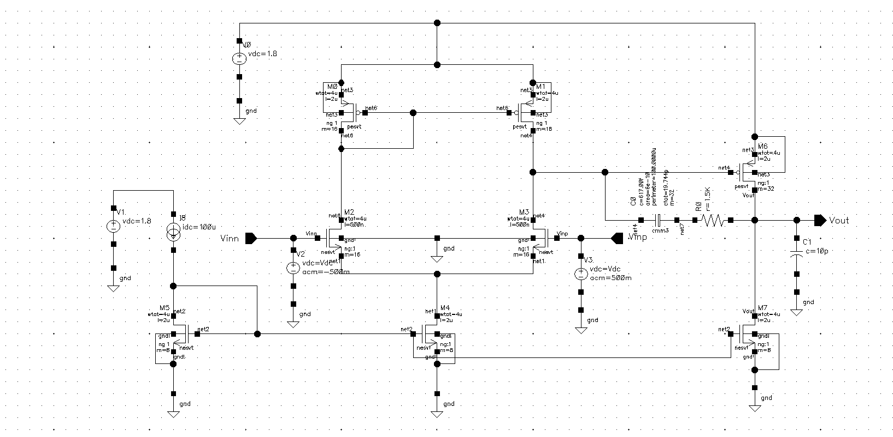
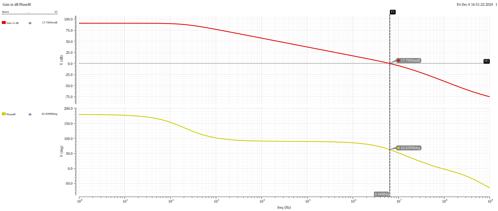

# Two-Stage Miller-Compensated OTA (180 nm CMOS)

A two-stage operational transconductance amplifier (OTA), also called an unbuffered op-amp, designed and simulated in Cadence Virtuoso. It drives a 10 pF capacitive load from a 1.8 V supply.

## Topology
- **Stage 1:** NMOS differential pair (M2/M3) with PMOS current-mirror load (M0/M1) and NMOS tail current source (M4).
- **Stage 2:** PMOS common-source amplifier (M6) with NMOS current-source load (M7).
- **Bias:** 100 µA reference (M5) mirrored to the tail and second stage.
- **Compensation:** Miller capacitor Cc = 19.74 pF in series with nulling resistor Rz = 1.5 kΩ.

There is no output buffer, so the output impedance is high. That is why this is an OTA (it drives capacitive loads) rather than a buffered op-amp.

## Results (AC simulation, CL = 10 pF)

| Parameter | Target | Simulated |
|---|---|---|
| DC gain | ≥ 90 dB | 90.9 dB |
| Unity-gain bandwidth | — | 6.46 MHz |
| Phase margin | ≥ 60° | 62.8° |
| Power (core, excl. 100 µA reference) | — | 0.36 mW (198.6 µA × 1.8 V) |

## Compensation
- Without Rz, the Miller capacitor creates a right-half-plane zero at gm6/Cc, which reduces phase margin.
- With Rz in series, the zero moves to 1 / (Cc · (1/gm6 − Rz)).
- Here gm6 = 774 µS, so 1/gm6 ≈ 1.29 kΩ. Since Rz = 1.5 kΩ is larger than 1/gm6, the zero moves into the left half-plane, at about 39 MHz, where it adds phase lead.
- First-order estimates are consistent with simulation:
  - UGB ≈ gm1 / (2π·Cc) ≈ 7.4 MHz (simulated 6.46 MHz).
  - Output pole ≈ gm6 / (2π·CL) ≈ 12 MHz, about 1.9 × UGB.

## Files
| File | Contents |
|---|---|
| `Miller_OTA.png` | Schematic |
| `Miller_OTA_dc_point.png` | DC operating point |
| `Miller_OTA_Gain in dB.png`, `Miller_OTA_Gain in mag.png`, `Miller_OTA_phase.png`, `Miller_OTA_phaseMargin.png` | AC response |
| `theoretical.pdf` | Hand derivations: transfer function, pole splitting, Miller theorem, stability |

## Reference
B. Razavi, *Design of Analog CMOS Integrated Circuits*, Ch. 10 (Stability and Frequency Compensation).
